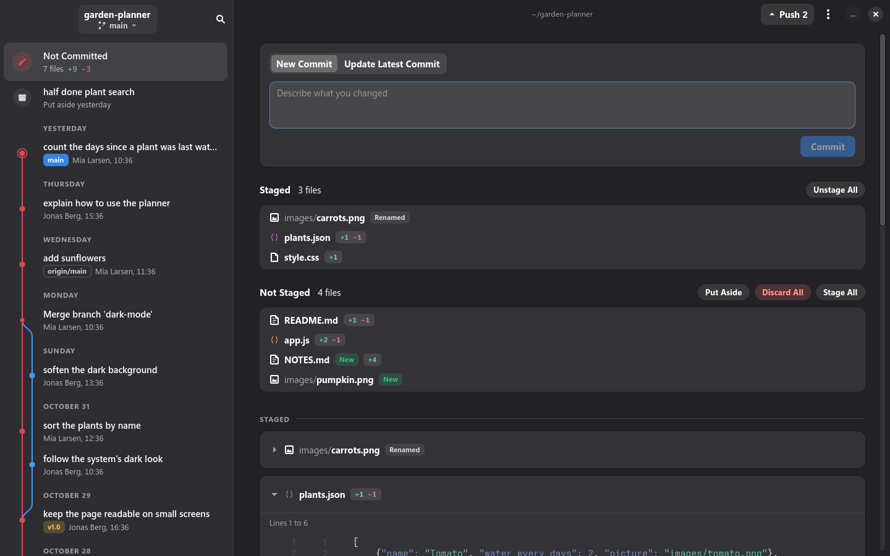

  

<h1 align="center">Crimson Changes</h1>

A Linux app that shows what changed in a Git folder, now and before. 
Open a folder to see your changes, the history and every branch.

  
  
  

  <a href="https://github.com/Crimson-Org/crimson-changes/releases/latest"><b>Download Here!</b></a>

  

## Why

Crimson Changes shows your current and past changes.\
Staging, branches and blame are there when you need them.

## About

### Now and before

Your changes that are not committed sit at the top, and the history follows below, grouped by day with its branches drawn as a graph.

### Changes you can read

Every change shows with the file's colours, and the words that changed inside a line stand out.\
Pictures show before and after.

### Undo

Committing, discarding and deleting a stash can be undone from the message that follows.

### Who changed each line

Blame shows who last changed each line and when, and selected lines show their whole history.

### A folder without Git

A folder without Git history can start tracking changes in a few clicks.

## Building

You need a [C compiler](https://gcc.gnu.org/), [pkg-config](https://www.freedesktop.org/wiki/Software/pkg-config/), [Git](https://git-scm.com/) and the development files for [GTK4](https://gtk.org), [libadwaita](https://gnome.pages.gitlab.gnome.org/libadwaita/) and [GtkSourceView](https://gitlab.gnome.org/GNOME/gtksourceview).\
On [openSUSE](https://www.opensuse.org/) these come from `sudo zypper install gcc pkg-config git gtk4-devel libadwaita-devel gtksourceview5-devel`.

Steps:
 1. Clone using `git clone --recurse-submodules https://github.com/Crimson-Org/crimson-changes`
 2. Run `sh .crimson-build/install.sh`

`sh .crimson-build/uninstall.sh` uninstalls Crimson Changes.
